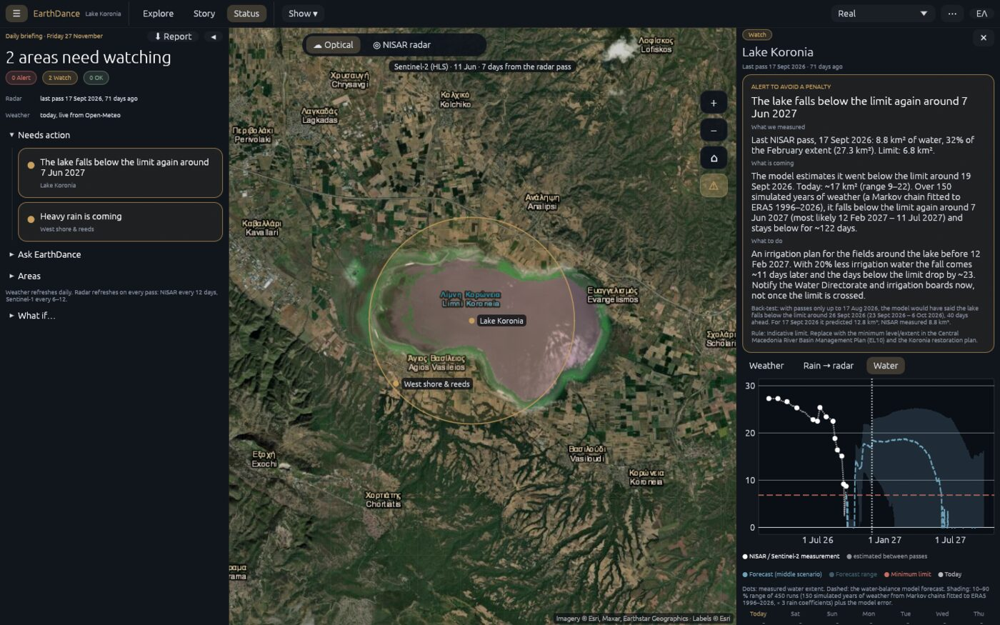
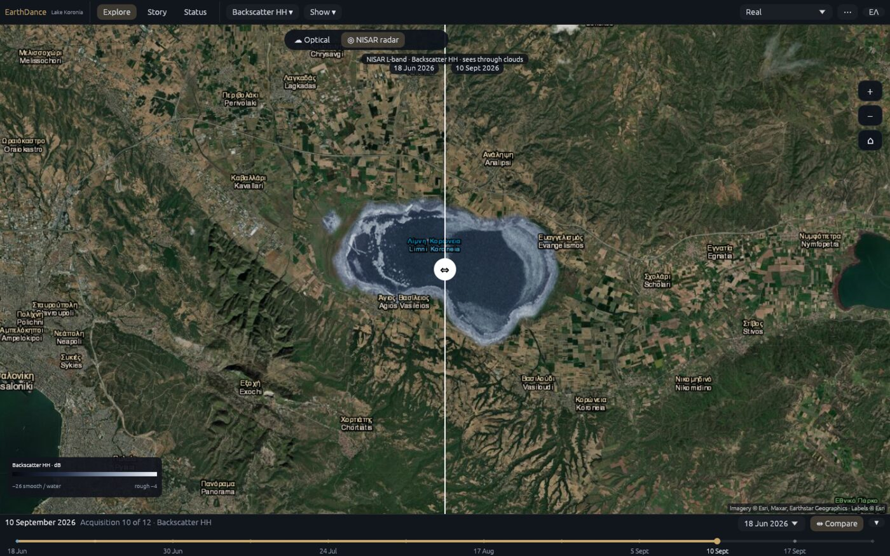
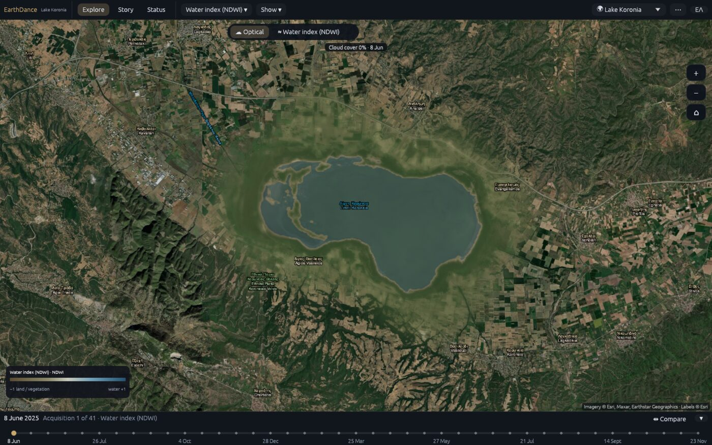

# EarthDance · Ο Χορός της Γης

**Satellite radar and optical data turned into a daily picture of a lake: how much water it holds, where
it is heading, and what the regional authority should do about it.**

Built for Lake Koronia (Central Macedonia, Greece) at the NASA Space Apps Challenge 2026,
*Dancing with the SARs*, where the team took **3rd place** and advanced to NASA's global round.
It now runs as a native desktop app and can open any lake that Sentinel-2 sees (checked at Koronia so
far; other lakes are still to be tested).



## What it does

| View | What you get |
|---|---|
| **Explore** | Radar and optical layers on a satellite basemap, a timeline of every acquisition, swipe-compare between two dates, the value under the cursor with a plain-language explanation, points with time series (and a sonified version you can listen to). |
| **Story** | Six short chapters for the general public: clouds → radar → water → reeds → sinking ground → decisions. |
| **Status** | The daily briefing for the region: which areas need action and why, the lake alert (what we measured · what is coming · what to do), weather, a "what if" for rain and irrigation, "Ask EarthDance", and a printable report. |

|  |  |
|---|---|
| Swipe compare, NISAR radar, 18 June vs 10 September 2026 | Anywhere on Earth: the dated Sentinel-2 picture around the lake |

## Run it

Requires a Rust toolchain (1.88 or newer, `rustup` recommended). On Linux, ALSA headers for sound
(`alsa-lib-devel` on Fedora, `libasound2-dev` on Debian/Ubuntu).

```bash
cargo run --release -p ed-app                    # Lake Koronia, real NISAR + Sentinel-2 data
cargo run --release -p ed-app -- --demo          # the demo set (all data made up, clearly labelled)
cargo run --release -p ed-app -- --place "Lake Volvi,23.48,40.68,10"   # any place: name,lon,lat,radius_km
```

Inside the app, **Source ▾ → Anywhere…** finds any lake by name (in any language; the lake's size sets
the area, and seasons come from its own climate); **Show ▾** picks the basemap
(satellite imagery or Sentinel-2 cloudless), place names, layer opacity and what is drawn. Keys: `←` `→` step through dates
(or Story chapters), `R` switches optical / radar, `Esc` closes dialogs.

No accounts or API keys are needed. The app downloads only what it needs and caches it in
`~/.cache/earthdance`, so a place opens instantly the second time and works offline afterwards. The map
warms up while the data loads, and zooming streams in the needed tiles in about a second.

## The three data sets

* **Real (Lake Koronia):** 19 NISAR L2 GCOV passes (June–September 2026; 12 kept, 2 of them empty files; the rest are steep-orbit
  or wind-roughened) and 16 Sentinel-2 (HLS)
  scenes, kept in `Koroneia_NISAR/` and `Koroneia_Sentinel/`, processed when the app starts.
* **Anywhere:** Sentinel-2 L2A for the last 18 months, streamed from the public AWS archive: clouds
  masked, water found with a threshold computed from the data, lake detected automatically.
* **Demo:** synthetic radar, subsidence, soil moisture, EGMS and points for the features that have no real
  data yet. Every screen says "Demo data".

## How it works

```
 satellite files / archive ──► ed-raster ──────────► Dataset ──► ed-core ──────────► ed-app
 (GeoTIFF, COG byte ranges)    warp, water, colour      │         rules, forecast,     map, views,
                                                        │         answers              charts, sound
 Open-Meteo (ERA5 + forecast) ───────────────────────────┘
```

| Crate | Role |
|---|---|
| `ed-core` | Domain model, the rules that turn numbers into findings, the lake water-balance forecast, the Markov-chain weather generator, gap filling, "Ask". Pure: no IO. |
| `ed-raster` | GeoTIFF / Cloud-Optimized GeoTIFF reading, UTM reprojection, filters, water detection, colouring. |
| `ed-sources` | Weather (Open-Meteo), satellite archives (STAC), basemap tiles, the disk cache, building data sets. |
| `ed-app` | The desktop app (egui). |

**The lake forecast.** A small water balance (rain in, evaporation and irrigation out) is fitted to the
measured lake areas. It runs forward on 150 simulated years of weather from a Markov-chain generator
fitted to the last 30 years of ERA5 at the lake. On 22 held-out years that forecasts the summer water
deficit 7 % better than replaying past years, with well-calibrated ranges. A forecast is shown only if the
fit passes a quality check.

**Between passes** the app draws estimates (dotted and labelled, never mixed with measurements): the
water balance run on the real weather between two passes, which beat every pure interpolation in a
leave-one-out test.

More detail, with the evaluations: [docs/rust-rewrite.md](docs/rust-rewrite.md).
One-page summary for the team: [docs/rust-rewrite-team-brief.pdf](docs/rust-rewrite-team-brief.pdf).

## How we know it is right

```bash
cargo test --workspace --release
```

* The rules, answers and forecasts are checked against what the original web app produced on the same
  inputs (`tests/fixtures/`, written by `oracle/gen.mjs`): every sentence matches in Greek and English.
* The raster pipeline reproduces the original Python outputs exactly, pixel for pixel.
* End to end: raw GeoTIFFs → findings identical to the original app.
* The daily briefing computes about 16× faster than the original JavaScript
  (`node oracle/bench.mjs` vs `cargo run --release -p ed-core --example bench_status`).

## Known limits and open questions

* **The two satellites disagree about Koronia.** Sentinel-2 sees about 26–31 km² of water all year; the
  NISAR radar saw about 9 km² in September 2026. Radar counts only calm open water; optical counts any
  water-looking surface. The alert uses the radar. This needs a field check.
* The lake's minimum limit (25 % of the largest measured area) is indicative. Replace it with the official
  value from the river basin management plan before using the alerts.
* Radar for arbitrary places is not wired in yet (Sentinel-1 needs no account; NISAR needs a free
  Earthdata token).
* The winter refill rate of Koronia is still uncertain: the radar record has no winter yet.
* The "what if" and the irrigation split (70 % irrigation, 30 % evaporation in summer) show direction, not
  exact amounts.

## Data and credits

NISAR L2 GCOV (NASA/ISRO, via ASF) · Sentinel-2 (Copernicus; HLS by NASA LP DAAC; L2A COGs on AWS via
Element 84 Earth Search) · ERA5 reanalysis and forecasts via [Open-Meteo](https://open-meteo.com)
(CC BY 4.0) · place search: GeoNames via Open-Meteo · basemap: Esri World Imagery and place names
(© Esri, Maxar, Earthstar Geographics) or Sentinel-2 cloudless by EOX (CC BY-NC-SA 4.0).

**Use of AI.** The Rust rewrite was written with Claude (Anthropic) under the team's direction; the
original prototype was also built with its help. The team reviews and runs the code and is responsible for
the data and the conclusions.

## The original web app

The first version (browser app in `index.html`, `js/`, `css/`, with Python tools in `tools/`) is still in
the repository and still runs: `python -m http.server 5173`, then open `http://localhost:5173`. The Rust
app is checked against it.
